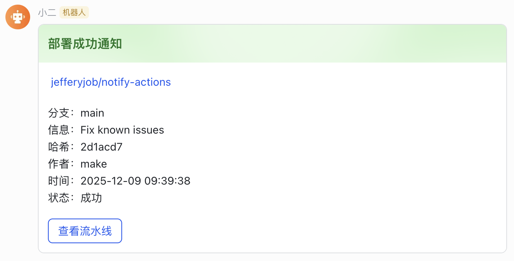
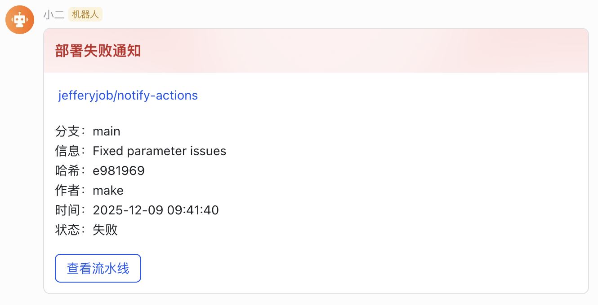

# Notification Actions
English | [简体中文](README.md)

## Introduction
A GitHub Action to send notifications to various messaging platforms (e.g., Feishu, DingTalk, Work WeChat, ShowDoc) based on deployment status.

## Features
- Supports multiple notification types.
- Allows sending messages in various formats (text, markdown, card).
- Can be used to notify about deployment statuses, making it easy to integrate into CI/CD pipelines.
- Customizable to fit different repository and workflow requirements.

## Example Workflow

```yaml
- name: Send Notification
  uses: jefferyjob/notify-actions@v1
  with:
    NOTICE_TYPE: ''
    MSG_TYPE: ''
    STATUS: ''
    WEBHOOK_URL: ''
    # FAIL_ON_ERROR: 'false'       # Optional, fail the action when the notification fails to send, default false
    # TIMEZONE: 'Asia/Shanghai'    # Optional, timezone used for the notification time, default Asia/Shanghai
```

## Parameter configuration
| Variable name | Required | Description                                                                                                                                   |
| ------------ | -------- |-----------------------------------------------------------------------------------------------------------------------------------------------|
| NOTICE_TYPE | Yes | Notification type (such as `feishu`, `dingtalk`, `workWechat`, `showDoc`).                                                                    |
| MSG_TYPE | Yes | Message format (such as `text`, `markdown`, `card`; `card` is only supported by `feishu`).                                                    |
| STATUS | Yes | Deployment status, `1` or `true` indicates success, `0` or `false` indicates failure, used to identify whether this deployment is successful. |
| WEBHOOK_URL | Yes | Webhook address of notification service, used to send deployment notifications to platforms such as Feishu and DingTalk. Passing it via secrets is recommended. |
| FAIL_ON_ERROR | No | Fail the action when the notification fails to send (network error or HTTP 4xx/5xx). Default `false` (warn and continue).                    |
| TIMEZONE | No | Timezone used for the notification time, e.g. `Asia/Shanghai`. Default `Asia/Shanghai`.                                                       |

## Notification type support
|            | text | markdown | Card |
| ---------- | ---- | ------- | ---- |
| feishu     | √    | √       | √    |
| dingtalk   | √    | √       | ×    |
| workWechat | √    | √       | ×    |
| showDoc    | √    | √       | ×    |

## Feishu notification diagram
**Project deployment success notification**



**Project deployment failure notification**



## License
This project is licensed under the [MIT License](LICENSE).
