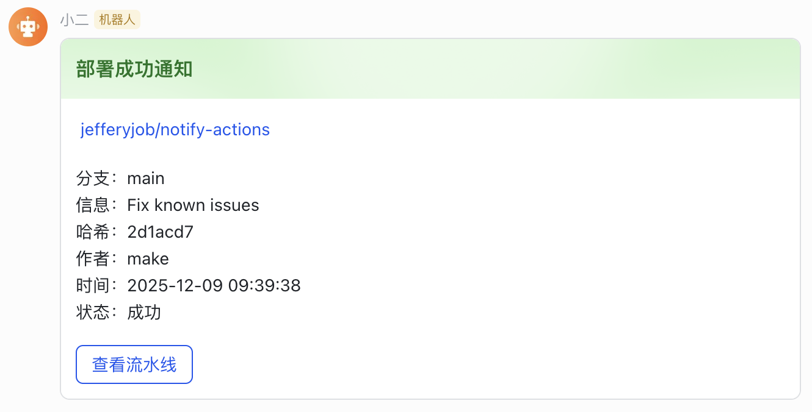
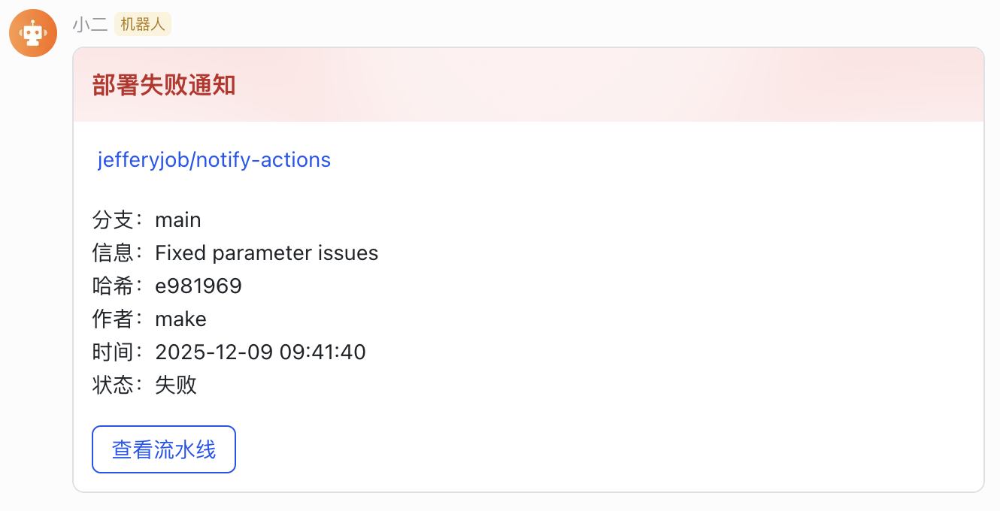

# Notification Actions
[English](README.en.md) | 简体中文

## 介绍
GitHub 操作可根据部署状态向各种消息平台（例如，飞书、钉钉、企业微信、ShowDoc）发送通知。

## 功能
- 支持多种通知类型。
- 允许以各种格式（文本、markdown、卡片）发送消息。
- 可用于通知部署状态，使其易于集成到 CI/CD 管道中。
- 可定制以适应不同的存储库和工作流要求。

## 示例工作流程

```yaml
- name: Send Notification
  uses: jefferyjob/notify-actions@v1
  with:
    NOTICE_TYPE: ''
    MSG_TYPE: ''
    STATUS: ''
    WEBHOOK_URL: ''
    # FAIL_ON_ERROR: 'false'       # 可选，通知发送失败时是否使 Action 失败，默认 false
    # TIMEZONE: 'Asia/Shanghai'    # 可选，通知时间使用的时区，默认 Asia/Shanghai
```

## 参数配置
| 变量名称 | 必需 | 说明                                                      |
| ------------ | -------- |---------------------------------------------------------|
| NOTICE_TYPE | 是 | 通知类型（如 `feishu`、`dingtalk`、`workWechat`、`showDoc`）。     |
| MSG_TYPE | 是 | 消息格式（如 `text`、`markdown`、`card`，其中 `card` 仅 `feishu` 支持）。 |
| STATUS     | 是    | 部署状态，`1` 或 `true` 表示成功，`0` 或 `false` 表示失败，用于标识本次部署是否成功。 |
| WEBHOOK_URL | 是    | 通知服务的 Webhook 地址，用于向如飞书、钉钉等平台发送部署通知。建议通过 secrets 传入。   |
| FAIL_ON_ERROR | 否 | 通知发送失败（网络错误或 HTTP 4xx/5xx）时是否使 Action 失败，`true` 表示失败，默认 `false`（仅告警并继续）。 |
| TIMEZONE | 否 | 通知中显示时间使用的时区，如 `Asia/Shanghai`，默认 `Asia/Shanghai`。 |

## 通知类型支持
|            | text | markdown | Card |
| ---------- | ---- | ------- | ---- |
| feishu     | √    | √       | √    |
| dingtalk   | √    | √       | ×    |
| workWechat | √    | √       | ×    |
| showDoc    | √    | √       | ×    |

## 飞书通知示意图
**项目部署成功通知**



**项目部署失败通知**



## 许可证
This project is licensed under the [MIT License](LICENSE).